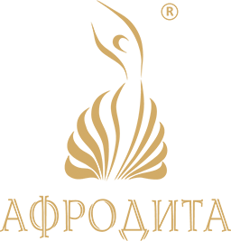

# Hair Craft House — Luxury Beauty Salon & Spa

<div align="center">
  
  <h1>Hair Craft House</h1>
  <p><strong>Премиальный салон красоты и SPA-центр</strong></p>
  <p><em>"Красота рождается внутри. Внутри салона Hair Craft House"</em></p>

  [](https://developer.mozilla.org/en-US/docs/Web/HTML)
  [](https://developer.mozilla.org/en-US/docs/Web/CSS)
  [](https://developer.mozilla.org/en-US/docs/Web/JavaScript)
  [](https://getbootstrap.com/)
</div>

---

## 📖 О проекте (Project Overview)

**Hair Craft House** — это современный многостраничный веб-сайт премиального салона красоты и SPA-комплекса. Веб-ресурс выполнен в утонченной эстетике с использованием фирменной палитры (золотой акцент `#C5A880`, глубокий черный фон, мягкий светлый тон `#F7F7F7`) и элегантной типографики Google Fonts (`Cormorant SC` и `Roboto Slab`).

Сайт разработан с акцентом на удобство пользователей, высокую конверсию и презентабельность: интуитивная навигация, интерактивный слайдер услуг, презентация звездных клиентов, блок преимуществ, детальные каталоги процедур на отдельных страницах, форма быстрой записи на прием с клиентской валидацией, а также полные основные и альтернативные контактные данные.

---

## 📞 Контактные данные (Contact Details)

В проекте представлены актуальные основные и альтернативные каналы связи для консультаций и записи клиентов:

| Канал связи | Детали / Ссылка |
| :--- | :--- |
| **Бренд** | **Hair Craft House** |
| **Основной телефон** | [+7 (963) 637-45-11](tel:+79636374511) |
| **Дополнительный телефон / Резерв** | [+7 (999) 999-99-99](tel:+79999999999) |
| **Email для клиентов и партнеров** | [info@haircrafthouse.com](mailto:info@haircrafthouse.com) |
| **WhatsApp Direct Chat** | [Написать в WhatsApp (+7 963 637-45-11)](https://wa.me/79636374511) |
| **Instagram** | [@haircrafthouse](https://instagram.com/haircrafthouse) |
| **Адрес и геолокация** | [Москва, ул. Петровка (Смотреть на Google Maps)](https://g.page/mayfair_petrovka?share) |
| **График работы** | Ежедневно: 10:00 — 22:00 |

---

## ✨ Основные возможности (Key Features)

- **Брендинг Hair Craft House**: Полное визуальное и текстовое обновление айдентики бренда на главной и всех сервисных страницах.
- **Интерактивный Hero-слайдер**: Bootstrap-карусель с высококачественными промо-изображениями процедур.
- **Специальное предложение ("Комплимент")**: Блок скидки 15% на первый визит с быстрым переходом к бронированию.
- **Модальная форма записи ("Мы вам перезвоним")**:
  - Всплывающее окно (`#staticBackdrop`) для ввода имени, телефона и сообщения.
  - Встроенная клиентская валидация полей через JavaScript (`script.js`).
  - Согласие с политикой обработки персональных данных.
  - Отображение прямых и альтернативных номеров телефонов внутри окна записи.
- **Звездные клиенты**: Фотогалерея знаменитых гостей и амбассадоров салона.
- **Интерактивный аккордеон преимуществ**: Раскрывающиеся секции с ключевыми достоинствами:
  - *Профессионализм* — ведущие сертифицированные мастера.
  - *Скорость* — VIP-кабинеты и одновременное оказание до 5 услуг.
  - *Качество* — препараты и косметика класса «Люкс».
  - *Комфорт* — премиальный интерьер и персональное обслуживание.
  - *Безопасность* — соблюдение строгих санитарных норм и медицинская лицензия.
- **Детальный прайс-навигатор**: Быстрый просмотр ориентировочных цен от 1500 руб. с кнопками перехода в тематические разделы.
- **Адаптивный подвал (Footer)**: Комплексный футер с логотипом, копирайтом, основным и альтернативным номерами, электронной почтой и кликабельными соцсетями.

---

## 🗂 Структура страниц сайта (Website Architecture)

Веб-ресурс разделен на логические страницы с индивидуальными карточками процедур и кнопками быстрой записи:

```text
HairCraft-House/
│
├── index.html          # Главная страница: о салоне, промо, клиенты, преимущества, прайс, контакты
├── Hair.html           # Парикмахерские услуги (стрижки, окрашивание, укладки, завивка, уходы)
├── Nails.html          # Ногтевой сервис (маникюр, SPA для рук, наращивание, педикюр, лечебный уход)
├── Cosmetic.html       # Косметология (пилинги, антивозрастные уходы, эпиляция, аппаратные и инъекционные методы)
├── SPA.html            # SPA-зона (релакс-программы, обертывание "Hair Craft House", массажи, флоатинг, души)
├── Visage.html         # Визаж (дневной, вечерний, свадебный макияж, архитектура бровей, ламинирование ресниц)
├── script.js           # JavaScript-обработчик валидации форм (Bootstrap Needs-Validation)
├── style.css           # Пользовательские стили, типографика, адаптивные медиа-запросы
├── icon.ico            # Фавиконка веб-сайта
├── icon.png            # Фирменный логотип салона
└── README.md           # Документация проекта
```

---

## 💇 Разделы услуг (Service Catalog)

### 1. ✂️ Парикмахерские услуги (`Hair.html`)
- **Стрижки**: женские, мужские, детские, креативные и модельные стрижки.
- **Окрашивание**: простое окрашивание, сложное мелирование, тонирование, шатуш, балаяж.
- **Укладки и прически**: повседневные, коктейльные, свадебные укладки и плетение кос.
- **Завивка**: биозавивка, кислотная, шелковая, японская завивка, долговременный карвинг.
- **Уходы**: восстанавливающие комплексы, кератиновое насыщение, программы «Блеск и сила».

### 2. 💅 Ногтевой сервис (`Nails.html`)
- **Маникюр**: аппаратный, классический обрезной, комбинированный, стойкое покрытие гель-лак.
- **SPA-уход для рук**: парафинотерапия, глубокое питание, массаж кистей.
- **Наращивание ногтей**: моделирование гелем и акрилом, укрепление ногтевой пластины.
- **Педикюр**: эстетический и аппаратный педикюр, спа-уход за стопами.
- **Лечебный педикюр**: подологическая обработка, решение проблемы вросших ногтей.

### 3. ✨ Косметология (`Cosmetic.html`)
- **Пилинги**: механический, энзимный, лазерный, ультразвуковой и химические пилинги.
- **Уходовые программы**: глубокое увлажнение, Anti-Age терапия, лифтинг, очищение проблемной кожи.
- **Эпиляция**: шугаринг, биоэпиляция воском, лазерная и электроэпиляция.
- **Аппаратные методики**: вакуумный лимфодренаж, RF-лифтинг, гидропилинг, безыгольная мезотерапия.
- **Инъекционные процедуры**: биоревитализация, мезотерапевтические коктейли, ботулинотерапия, контурная пластика.

### 4. 🌿 SPA-зона (`SPA.html`)
- **SPA-ритуалы**: программы «Гармония», «Райское наслаждение», «Магия шоколада».
- **Массажи**: традиционный тайский, стоун-терапия горячими камнями, аромамассаж, лимфодренажный массаж тела и лица.
- **Обертывания**: водорослевые, шоколадные, медовые, грязевые и фирменное обертывание **"Hair Craft House"**.
- **Водные процедуры**: камера сенсорной депривации (флоатинг), гидромассаж, циркулярный душ, душ Шарко и душ Виши.

### 5. 💄 Визаж (`Visage.html`)
- **Макияж**: естественный дневной нюд, яркий вечерний образ, фотомакияж, эксклюзивные техники.
- **Свадебный образ**: репетиция макияжа, выездное обслуживание невесты.
- **Брови**: архитектурное моделирование формы, долговременная укладка, окрашивание хной и краской.
- **Ресницы**: классическое и объемное наращивание 2D/3D, ламинирование, коллагенирование и ботокс ресниц.

---

## 🛠 Технологический стек (Tech Stack)

| Технология | Назначение |
| :--- | :--- |
| **HTML5** | Семантическая разметка страниц, структурирование контента и мета-тегов |
| **CSS3** | Кастомная стилизация, цветовая гамма, тени, скругления, адаптивная верстка |
| **JavaScript (ES6+)** | Логика валидации формы обратного звонка и интерактивных элементов |
| **Bootstrap 5** | Адаптивная сеточная система (Grid), модальные окна, выпадающие меню, карусель |
| **Google Fonts** | Премиальные шрифты `Cormorant SC` (заголовки) и `Roboto Slab` (текст) |
| **SVG Icons** | Векторные иконки социальных сетей (Instagram, WhatsApp, Geo) |

---

## 🚀 Запуск и просмотр проекта (How to Run)

Проект является статическим веб-сайтом и не требует сборки или установки серверных зависимостей.

### Вариант 1. Открытие в браузере
Просто дважды кликните по файлу `index.html` в проводнике Windows или перетащите его в любой современный браузер (Google Chrome, Microsoft Edge, Mozilla Firefox, Safari).

### Вариант 2. Локальный сервер (VS Code Live Server)
1. Откройте папку `HairCraft-House` в Visual Studio Code.
2. Установите расширение **Live Server**.
3. Нажмите кнопку **"Go Live"** в нижнем статус-баре редактора.

### Вариант 3. Запуск через Python
Если на компьютере установлен Python, выполните команду в папке проекта:
```bash
python -m http.server 8000
```
После этого перейдите в браузере по адресу: `http://localhost:8000`

---

## 📱 Адаптивность (Responsiveness)

Сайт полностью оптимизирован для отображения на различных типах устройств:
- **Десктопы и ноутбуки** (1200px+): полноразмерная навигация, многоколоночные карточки, просторный футер.
- **Планшеты** (768px - 1199px): адаптивная сетка, центрирование контента, пропорциональные размеры шрифтов.
- **Мобильные телефоны** (до 500px): гамбургер-меню, карточки в одну колонку, оптимизированные отступы формы бронирования и удобные кликабельные кнопки звонков.

---

## 📄 Лицензия и копирайт (Copyright)

© 2026 **Hair Craft House**. Все права защищены.
Проект создан для демонстрации премиальных услуг салона красоты и спа.

